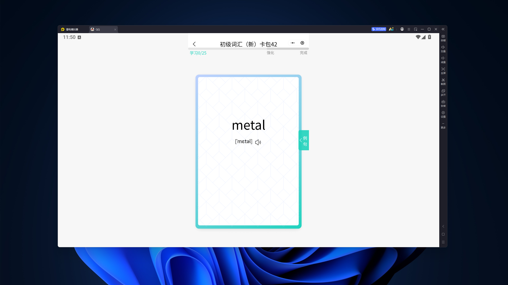
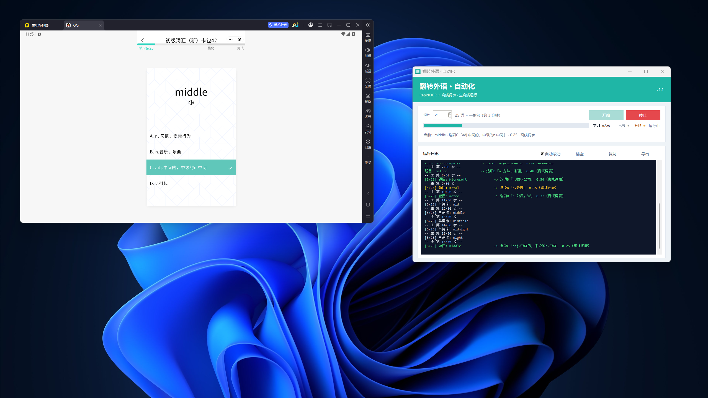

写在前面的话：
同学你好，学长在写这个软件时已经不需要打卡翻转外语了，甚至已经快毕业了，也有些许感慨，开发这个的原因也是纯属无聊，想给你们留点东西，于是就做了这个软（我大一的时候弄的，在自己用） 现在只能打卡卡包。
本项目使用 **GNU General Public License v3.0** 发布，不能用于商业用途。如果你有更好的建议或发现 bug，欢迎提交 Pull Request 或报告问题。我们共同完善这个工具。如果你觉得这个软件有帮助，欢迎给作者的github仓库点个星，感谢！

# 翻转外语 · 单词卡包自动答题（开源版）

一个 Windows 上的自动化小工具：用 **ADB 截屏 + RapidOCR 识别 + 离线词表判题**，
自动完成英语学习「单词卡包」练习（5 张词卡 + 5 道题为一组，共 5 组）。
全程离线，默认不依赖任何大模型，不需要联网。

- 支持雷电模拟器（LDPlayer），也兼容标准 Android `adb`
- 识别驱动，不依赖窗口位置/大小，窗口被挡住也能跑
- 判题走本地 40 万条英汉词表；答错时从 App 的对错高亮里学习正确答案
- 自带便携 Python 与全部依赖（`deps/`），解压即用
- 图形界面：词数、开始/停止、进度、已答/答错统计、彩色日志

> **免责声明**：本项目仅供个人学习与自动化技术研究使用。使用前请确认目标 App
> 的服务条款与当地法律法规，因使用本工具产生的一切后果由使用者自行承担。
> 本项目不提供、不内置任何题库或答案数据。

## 效果预览

| 模拟器停在卡包界面 | 程序自动答题中（图形界面 + 日志） |
| --- | --- |
|  |  |

---

## 一、快速开始

### 1. 环境准备

Windows 10 / 11（x64）
项目自带相关依赖，无需配置环境
安装雷电模拟器
在雷电模拟器中使用qq，在qq中打开翻转外语，停在卡包界面


### 2. 运行

**方式 A：源码运行（推荐开发者）**

直接双击 **`启动.bat`**，会打开图形界面：

1. 在「词数」里填本次要做的词数（默认 `25`，约等于一整包，3 分钟左右）
2. 点「开始」
3. 日志会实时滚动；点「停止」或关闭窗口会结束整个子进程树

**方式 B：单文件安装包（推荐普通用户）**

双击 **`翻转外语.exe`**：

1. 选择安装位置（默认上次位置，可修改或点「浏览…」）
2. 点「开始安装」，约 10~30 秒解压完成并启动界面
3. 桌面会生成「翻转外语」快捷方式，以后从快捷方式启动


命令行方式（可选）：

```bat
deps\python\python.exe 卡包.py            :: 按默认节奏跑
deps\python\python.exe 卡包.py 50         :: 按屏幕步数跑 50 步（1 词 ≈ 2 步）
deps\python\python.exe 卡包.py --走查 20   :: 只识别、不点击，安全试跑
deps\python\python.exe 卡包.py --调试      :: 只看当前这一屏识别结果
```

也可以用命令行菜单：

```bat
deps\python\python.exe run.py
```

### 3. 不想用自带依赖？

项目根目录的 `requirements.txt` 列出了直接依赖。用系统 Python 3.11+ 安装后，
把 `deps\site-packages_rapid` 和 `deps\rapidocr_models` 的模型放到对应位置，
或修改 `rapid_ocr.py` 里的 `_VENDOR` / `_MODELS` 路径即可。

```bat
pip install -r requirements.txt
```

---

## 二、目录结构

```
卡包.py            主程序：识别屏幕、判题、点击/滑动
UI.py              图形界面（tkinter）
run.py             命令行菜单
ldict.py           离线判题（词表 + 选项打分）
ldwin.py           窗口定位、截图、点击（ADB 常驻 shell / 鼠标双通道）
rapid_ocr.py       RapidOCR（PP-OCRv5 mobile / ONNX）封装
构建词表.py        从 ECDICT 重建 词典.tsv.gz（一次性脚本，需要联网）
启动.bat           启动入口（源码运行）
翻转外语.exe       单文件安装器（可选，约 94MB）
词典.tsv.gz        紧凑英汉词表（约 40 万条）
app.ico            程序图标
使用说明.txt       面向最终用户的简要说明
deps/
  python/            便携 Python 3.13（含 tkinter、Pillow）
  site-packages_rapid/  RapidOCR 及依赖（numpy / onnxruntime / opencv-headless 等）
  rapidocr_models/     PP-OCRv5 det/rec + 方向分类模型（ONNX）
  adb/                 adb 可执行文件
```

> 运行后会在程序目录生成 `已见单词.json`、`错题.json`、`界面配置.json` 等用户数据，
> 都属于本机记录，不需要提交到仓库（已在 `.gitignore` 中排除）。

---

## 三、工作原理

1. **取图**：通过 ADB 常驻 shell（`adb shell -T sh`）执行 `screencap -p | base64`，
   拿到的是安卓画面本身，与模拟器窗口位置、大小、是否被遮挡无关。
2. **识别**：RapidOCR（PP-OCRv5 mobile，ONNX，纯 CPU）识别整屏文字，
   热态约 0.3 秒/屏。
3. **判断屏幕类型**：
   - 行首匹配 `A./B./C./D.` + 中文 → 题目
   - 没有选项行 → 单词卡
   - 出现宽青色按钮/弹窗 → 结算页、完成页或提示
4. **判题**（全离线）：
   - 顺序：错题本 → 离线词表（强化轮先读卡片背面 App 释义）
   - 词表按"英文词释义「中文重合度」"给四个选项打分
   - 实在不确定时默认 **停下不乱蒙**（`UNSURE_ACTION = "stop"`）
   - 答错后读取点完题那一帧的青/红高亮，把正确选项写入 `错题.json`
5. **操作**：ADB `input tap/swipe` 点击选项或滑动翻页；也可切回鼠标模式。
6. **稳定性处理**：滑动后等画面停稳再识别、识别新手引导并点掉、卡片被滑出上沿时自动回滚、
   最后一题不再空等结算页、强化轮不再误判为题目。

### 性能参考

- 整屏 OCR：约 0.3 秒（CPU）
- 选项区域 OCR（学过一次位置后）：约 0.25~0.35 秒
- 一整包（25 词 / 50 屏）：约 2.5~3 分钟
- 实测连续整包 25/25 全对（RapidOCR + 离线词表）

---

## 四、可调配置

主要开关都在 `卡包.py` 顶部：

| 变量 | 默认 | 说明 |
| --- | --- | --- |
| `ROUNDS` / `STEPS_PER_ROUND` | `5` / `10` | 5 轮 × 10 屏 |
| `UNSURE_ACTION` | `"stop"` | 没把握时：`stop` 停下 / `first` 选 A / `random` 随机 |
| `LEARN_FROM_HIGHLIGHT` | `True` | 答错后从高亮学习正确答案 |
| `FAST_OPTION_OCR` | `True` | 只识别题干+选项区域，失败自动退回整屏 |
| `USE_VISION` | `False` | 启用 Ollama 视觉模型（可选，不需要） |
| `OCR_ENGINE` | `"rapid"` | OCR 引擎 |
| `PREFER_ADB`（`ldwin.py`） | `True` | `False` 时改用鼠标模拟 |

图形界面的「词数」会换算成屏幕步数（1 词 ≈ 2 屏）传给 `卡包.py`。

---

## 五、常见问题

| 现象 | 处理 |
| --- | --- |
| 提示"没找到雷电模拟器窗口" | 模拟器没开，或窗口标题不含「雷电/LDPlayer」 |
| 提示"RapidOCR 不可用" | `deps/` 不完整，重新下载完整仓库 |
| 点「开始」没反应 | 确认停在卡包首页/题目页；ADB 调试已开启 |
| 提示"没把握"停下 | 默认不乱蒙；可手动答掉这一题再继续 |
| 卡片被滑出上沿 | 程序会自动回滑恢复，无需干预 |
| 想换安装/运行目录 | 整个文件夹一起移动即可，不依赖注册表 |

---

## 六、第三方组件与许可证

本项目的**源代码**以 **GNU GPL v3.0** 发布（见 `LICENSE`）。
`deps/` 内为第三方组件，各自保留原许可证，随附于各 `*.dist-info/licenses/` 目录：

| 组件 | 版本 | 许可证 |
| --- | --- | --- |
| Python | 3.13.2 | PSF License |
| RapidOCR | 3.10.0 | Apache-2.0 |
| ONNX Runtime | 1.31.0 | MIT |
| NumPy | 2.5.4 | BSD-3-Clause |
| OpenCV (headless) | 5.0.0.93 | Apache-2.0 |
| Pillow | 12.1.0 | MIT-CMU |
| Shapely | 2.2.0 | BSD-3-Clause |
| pyclipper | 1.4.0 | MIT |
| PyYAML / six / tqdm / colorlog / omegaconf 等 | — | 各自 MIT/BSD/Apache |
| PP-OCRv5 / PP-OCRv2 模型 | — | Apache-2.0（PaddleOCR / RapidOCR 发布；随包版本已转为 fp16，词级识别与 fp32 逐字对比一致） |
| Android SDK Platform-Tools（adb） | — | Google Android SDK 许可 |
| ECDICT 词表（`词典.tsv.gz` 来源） | — | 见 skywind3000/ECDICT 仓库的许可证说明 |

> 分发时请保留上述组件的许可证文件。`deps/` 约 233MB，提交 Git 仓库会比较大；
> 如需精简仓库，可把 `deps/` 排除在 Git 之外，用 Release 附件或网盘分发。

---

## 七、开源协议

Copyright (C) 2026 翻转外语 contributors

本项目使用 **GNU General Public License v3.0** 发布。
你可以自由使用、修改和再分发，但衍生作品必须以相同协议开源，
且不提供任何担保。完整条款见 [LICENSE](LICENSE)。
